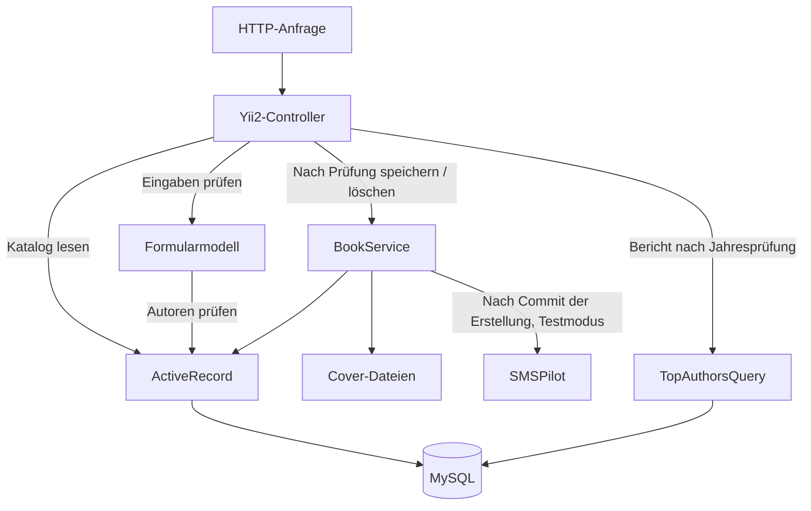

# Architektur

## Sprache wählen

| Русский | English | Español | 中文 | Français | Deutsch |
|---|---|---|---|---|---|
| [Русский](../../ru/reference/architecture.md) | [English](../../en/reference/architecture.md) | [Español](../../es/reference/architecture.md) | [中文](../../zh/reference/architecture.md) | [Français](../../fr/reference/architecture.md) | **Ausgewählt** |

Das Projekt nutzt die Standardfunktionen von Yii2 und fügt keine Schichten um ihrer selbst willen hinzu. ActiveRecord übernimmt den gewöhnlichen Datenzugriff, Form Models validieren Benutzereingaben, und zusammengesetzte Operationen werden dort ausgelagert, wo eine eigene Verantwortungsgrenze erforderlich ist.

## Überblick

Beispielsweise nimmt [`BookController`](../../../../controllers/BookController.php) die Anfrage entgegen, prüft die Zugriffsrechte, erhält die hochgeladene Datei und startet die Validierung. [`BookForm`](../../../../models/BookForm.php) prüft die Buchfelder, ausgewählten Autoren und das Bild. Nach erfolgreicher Validierung übergibt der Controller die Buchänderung an [`BookService`](../../../../services/BookService.php).

Der Controller kümmert sich damit weder um Transaktionen noch um das Dateisystem oder den SMS-Versand.

## Daten und Beziehungen

Die wichtigsten Modelle sind:

- [`Book`](../../../../models/Book.php) — Buch;
- [`Author`](../../../../models/Author.php) — Autor;
- [`Subscription`](../../../../models/Subscription.php) — Abonnement einer Telefonnummer für einen Autor;
- [`User`](../../../../models/User.php) — Benutzer, der den Katalog ändern darf.

Ein Buch kann mehrere Autoren haben und ein Autor mehrere Bücher. Die Beziehung liegt in der Tabelle `book_author`.

Die Datenbankstruktur wird durch [Migrationen](../../../../migrations/) festgelegt. Fremdschlüssel schützen die Beziehungen zwischen Tabellen, ein eindeutiger Index verhindert doppelte Buch-Autor-Paare, und ein eigener Index für das Erscheinungsjahr des Buchs unterstützt den Report.

Beim Anzeigen der Bücherliste werden Autoren mit `with('authors')` vorab geladen; dadurch ist keine separate Datenbankabfrage pro Buch nötig.

## Buch speichern

[`BookService`](../../../../services/BookService.php) ist erforderlich, weil eine Buchänderung mehrere Schritte umfasst: das Buch speichern, seine Autoren aktualisieren, das Bild verarbeiten und bei der Erstellung Abonnenten benachrichtigen.

Bei der Erstellung:

1. ein neues Bild wird unter einem generierten Namen gespeichert;
2. das Buch und seine Autorenbeziehungen werden in einer Transaktion geschrieben;
3. bei einem Fehler wird die Transaktion zurückgenommen und die neue Datei gelöscht;
4. nach erfolgreichem Abschluss der Transaktion beginnt der Benachrichtigungsversand.

Bei einer Aktualisierung bleibt das alte Bild erhalten, wenn keine neue Datei hochgeladen wird. Wird das Bild ersetzt, wird die alte Datei erst nach erfolgreichem Speichern des neuen Buchzustands gelöscht.

Beim Löschen wird zuerst die Entfernung des Datenbankeintrags bestätigt und danach die Bilddatei gelöscht.

So wird vermieden, dass ein gültiges Bild verschwindet, obwohl die Buchänderung in der Datenbank nicht gespeichert wurde.

## Top-10-Report

[`TopAuthorsReportForm`](../../../../models/TopAuthorsReportForm.php) validiert das ausgewählte Jahr; [`TopAuthorsQuery`](../../../../models/TopAuthorsQuery.php) erstellt den Report.

MySQL zählt mit einer einzigen Aggregatabfrage: Bücher werden nach Jahr gefiltert und nach Autoren gruppiert, anschließend werden die ersten zehn Ergebnisse ausgewählt. Bei gleicher Buchanzahl sorgen zusätzliche Sortierungen nach Autorenname und Kennung für eine vorhersehbare Reihenfolge.

Die Abfrage ist vom Controller getrennt, weil die Aggregation eine eigenständige Leseoperation und keine gewöhnliche Suche nach einem ActiveRecord-Modell ist.

## Eingabeprüfung und Zugriff

Benutzereingaben werden serverseitig validiert. Beispielsweise prüft [`BookForm`](../../../../models/BookForm.php) Pflichtfelder, Erscheinungsjahr, Existenz der ausgewählten Autoren und das hochgeladene Bild: erlaubte Erweiterungen, MIME-Typ und eine Größe bis 5 MiB.

Für katalogändernde Aktionen nutzen Controller `AccessControl`; `VerbFilter` erlaubt das Löschen nur per POST. Für gewöhnliche Webformulare gilt der CSRF-Schutz von Yii.

Datenbankabfragen verwenden ActiveRecord, Query Builder und parametrisierte Yii-Bedingungen; Benutzerwerte werden nicht per Zeichenkettenverkettung in SQL eingesetzt.

Geheimnisse einschließlich `SMSPILOT_API_KEY` werden aus der Umgebung und der Anwendungskonfiguration gelesen.

## Bewusst einfache Entscheidungen

ActiveRecord wird nicht für jedes Modell mit einem eigenen Repository umhüllt. In dieser Anwendung würde eine solche Schicht im Wesentlichen vorhandene Yii-Funktionen wiederholen, ohne nützliche Isolation zu bieten.

SMS werden nach dem Speichern eines Buchs synchron versendet. Bei größerer Last wäre eine Hintergrundwarteschlange besser; Yii2 bietet dafür die separate Erweiterung [`yiisoft/yii2-queue`](https://github.com/yiisoft/yii2-queue). Diese Testanwendung fügt keine Queue, keinen Worker und keine zugehörige Infrastruktur hinzu.

Die Anwendung bleibt eine serverseitig gerenderte Yii2-Webanwendung. Eine separate REST API oder SPA wurde nicht erstellt, weil die Aufgabe sie nicht verlangt.
